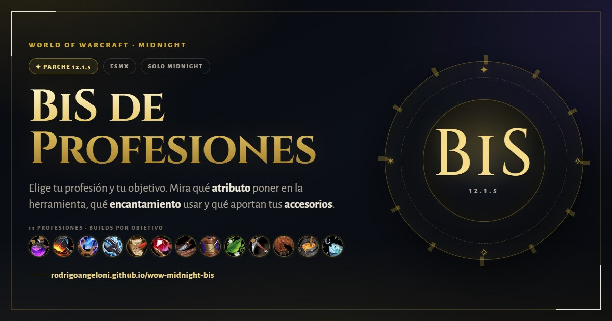

# ⚔️ WoW Midnight 12.1.5 · BiS de profesiones

**Guía visual e interactiva para elegir la build de profesión correcta en World of Warcraft: Midnight 12.1.5.** Elige una profesión y un objetivo para saber qué atributo poner en la herramienta, qué encantamiento usar y qué aportan los accesorios.

<p align="center">
  <a href="https://rodrigoangeloni.github.io/wow-midnight-bis/"></a>
  
  
</p>

<p align="center">
  <a href="https://rodrigoangeloni.github.io/wow-midnight-bis/">
    
  </a>
</p>

---

## 📖 Qué es

Sitio estático de una sola página pensado para resolver una duda concreta: **qué configuración llevar en la herramienta y los accesorios de cada profesión**. No requiere instalación, build ni backend.

- 🌙 Contenido limitado a **Midnight 12.1.5**; no mezcla objetos de expansiones anteriores.
- 🇲🇽 Nombres en **esMX** con equivalente en inglés para buscar en Wowhead.
- 🧭 Recomendaciones según objetivo: farmear, fabricar, subir calidad o ahorrar Concentración.
- 📋 Resumen copiable para compartir una build.

## ✨ Características

| | |
|---|---|
| 🧰 | **13 profesiones** — fabricación, recolección y secundarias. |
| 🎯 | **Asesor por objetivo** — cambia la misiva, el encantamiento y el perfil de stats. |
| 🔗 | **Enlaces a Wowhead esMX** — cada herramienta y accesorio abre su ficha. |
| 🖼️ | **Iconos con respaldo** — carga iconos de Wowhead y usa emojis si fallan. |
| 📱 | **Diseño responsive** — una sola página, sin frameworks ni build. |

## ▶️ Cómo usarla

1. Elige una profesión.
2. Elige lo que quieres hacer (farmear, fabricar, subir calidad, etc.).
3. Revisa la build recomendada y copia el resumen para compartirlo.

También puedes abrir directamente `index.html` en el navegador: no hace falta servidor ni instalar dependencias. Los scripts son clásicos y se cargan con `defer`, así que la página funciona incluso desde `file://`.

La guía de referencia completa está en [`docs/guia-bis-profesiones-midnight.md`](docs/guia-bis-profesiones-midnight.md).

## 🚀 Página publicada

**https://rodrigoangeloni.github.io/wow-midnight-bis/**

El sitio se publica con GitHub Pages desde la rama `main`; el contenido se sirve desde la raíz del repositorio.

## 🖼️ Imagen para compartir

`assets/img/og-image.jpg` (1200×630) es la imagen que se muestra al compartir el enlace por WhatsApp, Discord, Twitter/X y otras redes. El diseño fuente está en `design/og-image.html`; renderízalo a 1200×630 y guárdalo como `assets/img/og-image.jpg`.

## 🛠️ Tecnologías

- HTML5 semántico y CSS3 en `assets/css/styles.css`.
- JavaScript vanilla sin build: `assets/js/data.js` (datos) y `assets/js/app.js` (lógica).
- Scripts clásicos con `defer`, no módulos ES: la página funciona abriendo `index.html` directamente.
- Fuentes de Google Fonts e iconos del CDN de Wowhead, con respaldo en emojis.

## 📁 Estructura

```text
.
├── index.html                           # Estructura y contenido de la página
├── assets/
│   ├── css/
│   │   └── styles.css                   # Estilos
│   ├── js/
│   │   ├── data.js                      # Datos de stats, profesiones y objetos
│   │   └── app.js                       # Render e interacción
│   └── img/
│       ├── favicon.svg                  # Icono del sitio
│       └── og-image.jpg                 # Imagen para compartir (1200×630)
├── docs/
│   └── guia-bis-profesiones-midnight.md # Guía de referencia en Markdown
├── design/
│   ├── og-image.html                    # Diseño fuente de la imagen social
│   └── og-image.png                     # Export PNG sin uso en la página
├── .nojekyll                            # Evita el procesamiento de Jekyll en Pages
└── README.md
```

## 👨‍💻 Créditos

- **Creado y mantenido por** [Rodrigo Angeloni](https://github.com/rodrigoangeloni).
- **Datos y nombres verificados en** [Wowhead esMX](https://www.wowhead.com/mx).
- **Fuentes de referencia:** [Icy Veins](https://www.icy-veins.com/wow/professions), [Wowhead](https://www.wowhead.com/guide/midnight/professions) y [Wow-Professions](https://www.wow-professions.com/midnight/).
- **Hecho para la hermandad**, con cariño por las profesiones de WoW.

## ⚠️ Aviso

Guía de referencia, no sustituye la comprobación en el juego. Los valores pueden variar según la calidad y el nivel de objeto; verifica siempre antes de comprar o fabricar.
